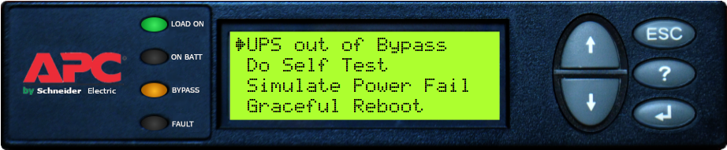

# PX Emulator

A browser-based emulator that recreates the display and menu navigation of APC™ and Schneider Electric™ UPS systems, including the Symmetra PX 250/500 (PX1), Symmetra PX2, and other supported platforms.

The application allows Technical Support Engineers (TSEs), Field Service Representatives (FSRs), and training personnel to navigate UPS menus exactly as a customer would see them in the field, making remote troubleshooting and training more effective.



---

## Purpose

During support calls, engineers frequently need to guide customers through complex menu structures to locate measurements, alarms, event logs, settings, and configuration parameters.

The PX Emulator provides a virtual UPS display that can be used to:

- Follow menu navigation while assisting customers
- Learn and practice UPS display layouts
- Verify menu paths before providing instructions
- Train new support engineers
- Demonstrate product functionality without physical hardware
- Improve confidence and accuracy during troubleshooting

---

## Features

### UPS Display Simulation

- Realistic LCD display interface
- Simulated keypad navigation
- Authentic menu structures
- Multiple supported UPS platforms
- Fast screen response and navigation

### Technical Support Tool

- Follow customer navigation in real time
- Verify instructions before giving them to customers
- Reduce errors during support calls
- Improve first-call resolution

### Training Platform

- Familiarize engineers with product interfaces
- Practice menu navigation without access to equipment
- Train new support and field personnel
- Demonstrate UPS functionality in classroom or virtual environments

---

## Supported Platforms

Current support includes:

- Symmetra PX 250/500 (PX1)
- Symmetra PX2

Additional UPS platforms may be added in future releases.

---

## Technology Stack

- JavaScript
- HTML5
- CSS3

The emulator runs entirely in a web browser and does not require server-side components.

---

## Getting Started

### Clone the Repository

```bash
git clone https://github.schneider-electric.com/SESA91827/PX-Emulator.git
```

### Run the Application

Open the main HTML file in your browser:

```text
index.html
```

Alternatively, host the project using any local web server.

---

## Usage

1. Launch the application.
2. Select the desired UPS platform.
3. Navigate the display using the on-screen controls.
4. Follow menu paths as if operating the physical equipment.
5. Use the emulator alongside customer calls, training sessions, or demonstrations.

---

## Typical Use Cases

### Customer Support

A customer reports an alarm and needs assistance locating diagnostic information.

The engineer